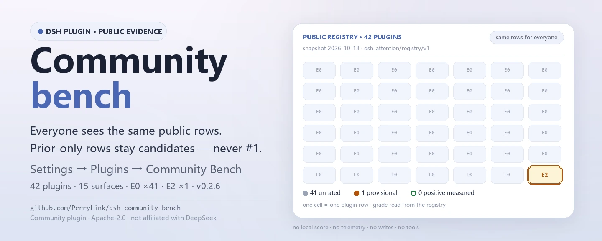
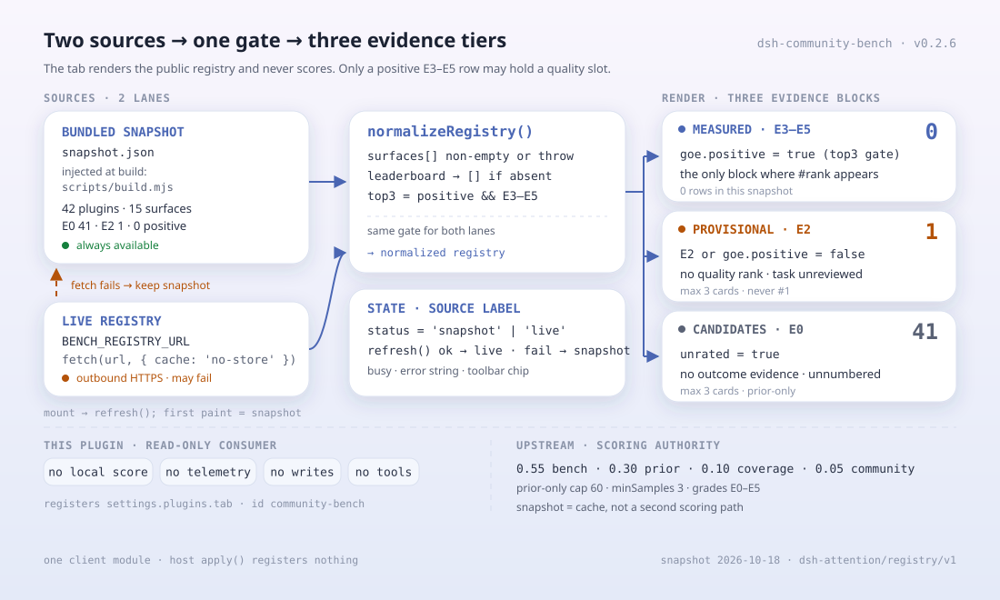

<div align="center">

<picture>
  <source media="(prefers-color-scheme: dark)" srcset="docs/assets/dsh-community-bench-hero-en-dark.webp">
  
</picture>

# dsh-community-bench

**Pestaña Community Bench dentro de la app para la capa de evidencia pública de `dsh-score`.**

*Lee el mismo registro público que ve todo el mundo. Sin puntuación local, sin telemetría, sin rango pagado.*

[English](README.md) · [简体中文](README-zh.md) · [Español](README-es.md) · [Português](README-pt.md) · [हिन्दी](README-hi.md)

> 🧊 **CONGELADO — 2026-10-31. Modo de mantenimiento.** Sin nuevas funciones de puntuación ni de ranking; el paquete sigue siendo instalable.

[](LICENSE)
[](#compatibility)
[](https://www.npmjs.com/package/dsh-community-bench)
[](#compatibility)

[](https://github.com/PerryLink/dsh-community-bench/stargazers)
[](https://www.npmjs.com/package/dsh-community-bench)
[](https://dshfind.com/plugins/PerryLink/dsh-community-bench?ref=badge)
[](https://gitee.com/perrylink/dsh-community-bench)

```sh
dsh plugin --profile web add dsh-community-bench
```

</div>

<sub>Plugin de la comunidad, no afiliado a DeepSeek. Repositorio canónico: <https://github.com/PerryLink/dsh-community-bench> (Gitee es un espejo).</sub>

---

> **Estado: consumidor de referencia / modo de mantenimiento.** Sin nuevas funciones de puntuación ni de ranking. La capa de evidencia pública es `dsh-score-index` (actualmente `dsh-attention-index`; el cambio de nombre del repo está pendiente).

## Qué muestra

- GOE (`E0`–`E5`) por superficie. En la instantánea actual: 41 filas son `E0 / unrated`, 1 fila es `E2 / provisional` (un pilot nulo); ninguna fila positive measured.
- Las filas positive measured solo aparecen en el bloque de calidad; las filas prior-only se etiquetan como candidatas, nunca como `#1`.
- Prior, bench, cobertura y **completitud de la evidencia** (no una probabilidad de confianza).
- Bloques de atención de la comunidad y reputación de colaboradores.
- Enlace al sitio público de evidencia y un botón de actualización.

La pestaña es un **consumidor**: la evidencia y la calificación viven en el registro público, no en este plugin. Si el registro en vivo no es accesible, vuelve a la instantánea incluida y lo indica.

<picture>
  <source media="(prefers-color-scheme: dark)" srcset="docs/assets/dsh-community-bench-flow-v5-dark.svg">
  
</picture>

*Estructura: dos vías (instantánea inyectada en la compilación y registro en vivo) → una puerta `normalizeRegistry()` → tres bloques de evidencia; solo una fila positive E3–E5 puede ocupar una ranura de calidad, un fetch fallido mantiene la instantánea y los pesos de puntuación se quedan aguas arriba. Las etiquetas de token dentro del diagrama son identificadores reales, así que la misma imagen sirve para los cinco idiomas.*

## Instalación

```sh
dsh plugin --profile web add dsh-community-bench
```

Luego abre **Settings → Plugins → Community Bench**.

## Configuración

La compilación inyecta dos URL (`scripts/build.mjs`):

| Variable de entorno en la compilación | Valor por defecto |
|---|---|
| `BENCH_SITE_URL` | `https://perrylink.github.io/dsh-attention-index/` |
| `BENCH_REGISTRY_URL` | `https://raw.githubusercontent.com/PerryLink/dsh-attention-index/main/data/registry.json` |

Si el registro se aloja en otro sitio, recompila con esas variables.

## Límites

- La instantánea incluida se genera a partir de `dsh-attention-index/data/registry.json`; es una caché, no una segunda vía de puntuación.
- La consulta en vivo depende de que el host permita HTTPS saliente desde la Web app; si falla, la pestaña se queda en la instantánea.
- Sin escrituras locales, sin telemetría, sin herramientas.

## Evaluación


*Animado: el propio paso de compilación del repositorio y un dry-run del paquete, reejecutados el 2026-11-21. La pestaña es una vista solo de cliente sin CLI, así que esta es su ejecución: la instantánea incluida se inyecta en `client.js` y los medios de documentación viajan con el paquete npm. No hay red ni captura de UI.*

## La familia de plugins DSH

| Proyecto | Rol |
|---|---|
| **[dsh-aqua-input-check](https://github.com/PerryLink/dsh-aqua-input-check)** |  |
| **[dsh-archive-check](https://github.com/PerryLink/dsh-archive-check)** |  |
| **[dsh-auto-review](https://github.com/PerryLink/dsh-auto-review)** |  |
| **[dsh-bid-ca-precheck](https://github.com/PerryLink/dsh-bid-ca-precheck)** |  |
| **[dsh-bid-qual-check](https://github.com/PerryLink/dsh-bid-qual-check)** |  |
| **[dsh-check-pack](https://github.com/PerryLink/dsh-check-pack)** |  |
| **[dsh-checkpoint-rewind](https://github.com/PerryLink/dsh-checkpoint-rewind)** |  |
| **[dsh-click](https://github.com/PerryLink/dsh-click)** |  |
| **[dsh-clinic](https://github.com/PerryLink/dsh-clinic)** |  |
| **[dsh-codemod](https://github.com/PerryLink/dsh-codemod)** |  |
| **[dsh-composer-history](https://github.com/PerryLink/dsh-composer-history)** |  |
| **[dsh-contract-stance](https://github.com/PerryLink/dsh-contract-stance)** |  |
| **[dsh-customs-doc-check](https://github.com/PerryLink/dsh-customs-doc-check)** |  |
| **[dsh-data-quality](https://github.com/PerryLink/dsh-data-quality)** |  |
| **[dsh-demurrage-ledger](https://github.com/PerryLink/dsh-demurrage-ledger)** |  |
| **[dsh-dida](https://github.com/PerryLink/dsh-dida)** |  |
| **[dsh-doublecheck](https://github.com/PerryLink/dsh-doublecheck)** |  |
| **[dsh-drill-script-check](https://github.com/PerryLink/dsh-drill-script-check)** |  |
| **[dsh-eia-guide-check](https://github.com/PerryLink/dsh-eia-guide-check)** |  |
| **[dsh-emergency-plan](https://github.com/PerryLink/dsh-emergency-plan)** |  |
| **[dsh-essay-rubric-check](https://github.com/PerryLink/dsh-essay-rubric-check)** |  |
| **[dsh-evidence-check](https://github.com/PerryLink/dsh-evidence-check)** |  |
| **[dsh-export-ctl-check](https://github.com/PerryLink/dsh-export-ctl-check)** |  |
| **[dsh-fast](https://github.com/PerryLink/dsh-fast)** |  |
| **[dsh-fmea-table-check](https://github.com/PerryLink/dsh-fmea-table-check)** |  |
| **[dsh-forecast-penalty](https://github.com/PerryLink/dsh-forecast-penalty)** |  |
| **[dsh-fund-research](https://github.com/PerryLink/dsh-fund-research)** |  |
| **[dsh-github-bot](https://github.com/PerryLink/dsh-github-bot)** |  |
| **[dsh-gongwen-flow-check](https://github.com/PerryLink/dsh-gongwen-flow-check)** |  |
| **[dsh-gongwen-word-check](https://github.com/PerryLink/dsh-gongwen-word-check)** |  |
| **[dsh-guard-plan-qc](https://github.com/PerryLink/dsh-guard-plan-qc)** |  |
| **[dsh-hazchem-check](https://github.com/PerryLink/dsh-hazchem-check)** |  |
| **[dsh-hazplan-check](https://github.com/PerryLink/dsh-hazplan-check)** |  |
| **[dsh-hidden-risk-map](https://github.com/PerryLink/dsh-hidden-risk-map)** |  |
| **[dsh-hs-classify](https://github.com/PerryLink/dsh-hs-classify)** |  |
| **[dsh-icd-rule-check](https://github.com/PerryLink/dsh-icd-rule-check)** |  |
| **[dsh-industry-research](https://github.com/PerryLink/dsh-industry-research)** |  |
| **[dsh-lawcite-adapter](https://github.com/PerryLink/dsh-lawcite-adapter)** |  |
| **[dsh-laya](https://github.com/PerryLink/dsh-laya)** |  |
| **[dsh-lc-doc-check](https://github.com/PerryLink/dsh-lc-doc-check)** |  |
| **[dsh-learning-gap-check](https://github.com/PerryLink/dsh-learning-gap-check)** |  |
| **[dsh-library](https://github.com/PerryLink/dsh-library)** |  |
| **[dsh-local-ai](https://github.com/PerryLink/dsh-local-ai)** |  |
| **[dsh-lsp-actions](https://github.com/PerryLink/dsh-lsp-actions)** |  |
| **[dsh-mask](https://github.com/PerryLink/dsh-mask)** |  |
| **[dsh-mcp-panel](https://github.com/PerryLink/dsh-mcp-panel)** |  |
| **[dsh-medrec-qc](https://github.com/PerryLink/dsh-medrec-qc)** |  |
| **[dsh-memento](https://github.com/PerryLink/dsh-memento)** |  |
| **[dsh-nsfc-form-check](https://github.com/PerryLink/dsh-nsfc-form-check)** |  |
| **[dsh-nurse-record-check](https://github.com/PerryLink/dsh-nurse-record-check)** |  |
| **[dsh-observe](https://github.com/PerryLink/dsh-observe)** |  |
| **[dsh-origin-rvc-check](https://github.com/PerryLink/dsh-origin-rvc-check)** |  |
| **[dsh-ota-review-check](https://github.com/PerryLink/dsh-ota-review-check)** |  |
| **[dsh-output-styles](https://github.com/PerryLink/dsh-output-styles)** |  |
| **[dsh-paper-doc-adapter](https://github.com/PerryLink/dsh-paper-doc-adapter)** |  |
| **[dsh-param-repair](https://github.com/PerryLink/dsh-param-repair)** |  |
| **[dsh-permission-rules](https://github.com/PerryLink/dsh-permission-rules)** |  |
| **[dsh-permit-report-check](https://github.com/PerryLink/dsh-permit-report-check)** |  |
| **[dsh-phocinae](https://github.com/PerryLink/dsh-phocinae)** |  |
| **[dsh-phone-inbox](https://github.com/PerryLink/dsh-phone-inbox)** |  |
| **[dsh-pipeline-check](https://github.com/PerryLink/dsh-pipeline-check)** |  |
| **[dsh-pleading-draft](https://github.com/PerryLink/dsh-pleading-draft)** |  |
| **[dsh-policy-brief-draft](https://github.com/PerryLink/dsh-policy-brief-draft)** |  |
| **[dsh-power-loss-split](https://github.com/PerryLink/dsh-power-loss-split)** |  |
| **[dsh-power-ticket-check](https://github.com/PerryLink/dsh-power-ticket-check)** |  |
| **[dsh-ppap-check](https://github.com/PerryLink/dsh-ppap-check)** |  |
| **[dsh-primer](https://github.com/PerryLink/dsh-primer)** |  |
| **[dsh-protest-deadline](https://github.com/PerryLink/dsh-protest-deadline)** |  |
| **[dsh-railway-window](https://github.com/PerryLink/dsh-railway-window)** |  |
| **[dsh-repair-order-qc](https://github.com/PerryLink/dsh-repair-order-qc)** |  |
| **[dsh-research-report](https://github.com/PerryLink/dsh-research-report)** |  |
| **[dsh-review-reply-check](https://github.com/PerryLink/dsh-review-reply-check)** |  |
| **[dsh-rulefile-check](https://github.com/PerryLink/dsh-rulefile-check)** |  |
| **[dsh-safety-brief-check](https://github.com/PerryLink/dsh-safety-brief-check)** |  |
| **[dsh-scaffold](https://github.com/PerryLink/dsh-scaffold)** |  |
| **[dsh-score](https://github.com/PerryLink/dsh-score)** | Inspector local de priors de cinco dimensiones |
| **[dsh-security-pack](https://github.com/PerryLink/dsh-security-pack)** |  |
| **[dsh-session-sync](https://github.com/PerryLink/dsh-session-sync)** |  |
| **[dsh-site-log-check](https://github.com/PerryLink/dsh-site-log-check)** |  |
| **[dsh-soe-decision-check](https://github.com/PerryLink/dsh-soe-decision-check)** |  |
| **[dsh-soilwater-check](https://github.com/PerryLink/dsh-soilwater-check)** |  |
| **[dsh-sop-sync-check](https://github.com/PerryLink/dsh-sop-sync-check)** |  |
| **[dsh-spc-gbt-adapter](https://github.com/PerryLink/dsh-spc-gbt-adapter)** |  |
| **[dsh-talk](https://github.com/PerryLink/dsh-talk)** |  |
| **[dsh-tender-extract](https://github.com/PerryLink/dsh-tender-extract)** |  |
| **[dsh-tender-matrix](https://github.com/PerryLink/dsh-tender-matrix)** |  |
| **[dsh-test-drive](https://github.com/PerryLink/dsh-test-drive)** |  |
| **[dsh-warranty-calc](https://github.com/PerryLink/dsh-warranty-calc)** |  |
| **[dsh-autotier](https://github.com/PerryLink/dsh-autotier)** | 🧊 CONGELADO — ver el README del repositorio |
| **[dsh-budget](https://github.com/PerryLink/dsh-budget)** | 🧊 CONGELADO — ver el README del repositorio |
| **[dsh-cert-mcp](https://github.com/PerryLink/dsh-cert-mcp)** | 🧊 CONGELADO — ver el README del repositorio |
| **[dsh-claude-move](https://github.com/PerryLink/dsh-claude-move)** | 🧊 CONGELADO — ver el README del repositorio |
| **[dsh-community-bench](https://github.com/PerryLink/dsh-community-bench)** | 🧊 CONGELADO — ver el README del repositorio |
| **[dsh-defend](https://github.com/PerryLink/dsh-defend)** | 🧊 CONGELADO — ver el README del repositorio |
| **[dsh-draw](https://github.com/PerryLink/dsh-draw)** | 🧊 CONGELADO — ver el README del repositorio |
| **[dsh-reach](https://github.com/PerryLink/dsh-reach)** | 🧊 CONGELADO — ver el README del repositorio |
| **[dsh-background-agents](https://github.com/PerryLink/dsh-background-agents)** | 🚫 RETIRADO — ver el README del repositorio |
| **[dsh-session-pin](https://github.com/PerryLink/dsh-session-pin)** | 🚫 RETIRADO — ver el README del repositorio |
| **[dsh-team-rooms](https://github.com/PerryLink/dsh-team-rooms)** | 🚫 RETIRADO — ver el README del repositorio |

## ⭐ Si te ha resultado útil

Este plugin forma parte de una [familia de plugins DSH](https://github.com/PerryLink) (40+, todos Apache-2.0). Si te resulta útil, **una estrella ayuda a que la siguiente persona lo encuentre** — nada está bloqueado detrás de ella.

## Licencia

Apache-2.0.
