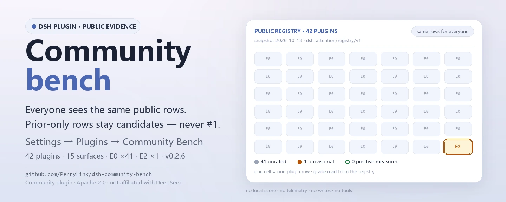
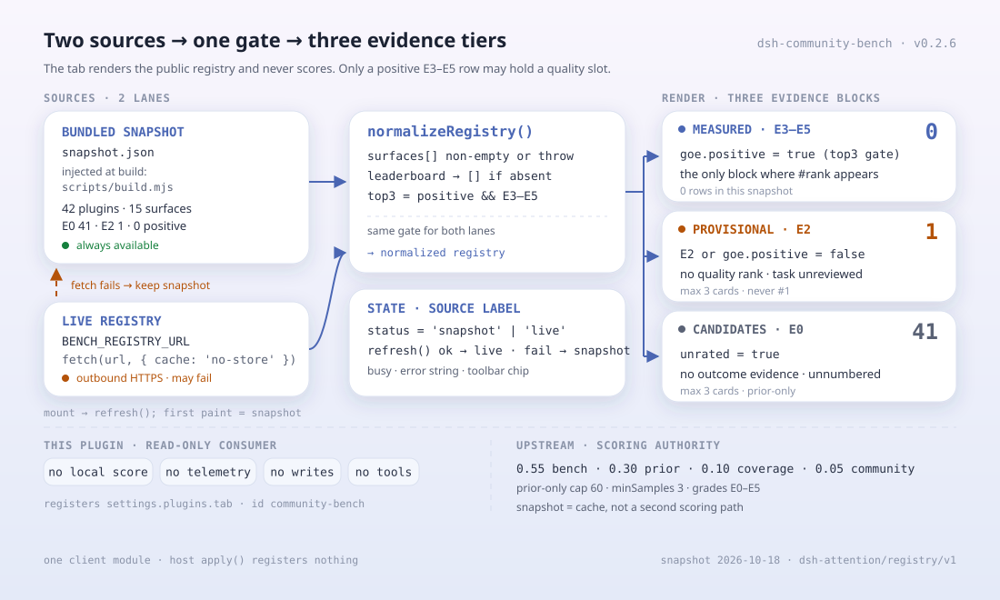

<div align="center">

<picture>
  <source media="(prefers-color-scheme: dark)" srcset="docs/assets/dsh-community-bench-hero-en-dark.webp">
  
</picture>

# dsh-community-bench

**`dsh-score` सार्वजनिक एविडेंस लेयर के लिए ऐप के अंदर का Community Bench टैब।**

*वही सार्वजनिक रजिस्ट्री पढ़ता है जो सब देखते हैं। कोई स्थानीय स्कोरिंग नहीं, कोई टेलीमेट्री नहीं, कोई पेड रैंक नहीं।*

[English](README.md) · [简体中文](README-zh.md) · [Español](README-es.md) · [Português](README-pt.md) · [हिन्दी](README-hi.md)

> 🧊 **2026-10-31 से फ़्रोज़न, मेंटेनेंस मोड।** कोई नया स्कोरिंग या रैंकिंग फ़ीचर नहीं; पैकेज इंस्टॉल होने योग्य बना रहता है।

[](LICENSE)
[](#compatibility)
[](https://www.npmjs.com/package/dsh-community-bench)
[](#compatibility)

[](https://github.com/PerryLink/dsh-community-bench/stargazers)
[](https://www.npmjs.com/package/dsh-community-bench)
[](https://dshfind.com/plugins/PerryLink/dsh-community-bench?ref=badge)
[](https://gitee.com/perrylink/dsh-community-bench)

```sh
dsh plugin --profile web add dsh-community-bench
```

</div>

<sub>समुदाय का प्लगइन, DeepSeek से संबद्ध नहीं। कैनोनिकल रिपॉज़िटरी: <https://github.com/PerryLink/dsh-community-bench> (Gitee एक मिरर है)।</sub>

---

> **स्थिति: संदर्भ कंज़्यूमर / मेंटेनेंस मोड।** कोई नया स्कोरिंग या रैंकिंग फ़ीचर नहीं। सार्वजनिक एविडेंस लेयर `dsh-score-index` है (फ़िलहाल `dsh-attention-index`; repo का नाम बदलना बाकी है)।

## यह क्या दिखाता है

- प्रति सरफ़ेस GOE (`E0`–`E5`)। मौजूदा स्नैपशॉट में: 41 पंक्तियाँ `E0 / unrated` हैं, 1 पंक्ति `E2 / provisional` है (एक null pilot); कोई positive measured पंक्ति नहीं।
- positive measured पंक्तियाँ केवल क्वालिटी ब्लॉक में; prior-only पंक्तियाँ उम्मीदवार के रूप में लेबल होती हैं, कभी `#1` नहीं।
- Prior, bench, कवरेज और **एविडेंस की पूर्णता** (विश्वास की प्रायिकता नहीं)।
- समुदाय के ध्यान वाले ब्लॉक और योगदानकर्ताओं की प्रतिष्ठा।
- सार्वजनिक एविडेंस साइट का लिंक और एक रीफ़्रेश बटन।

यह टैब एक **कंज़्यूमर** है: एविडेंस और ग्रेडिंग सार्वजनिक रजिस्ट्री में रहते हैं, इस प्लगइन में नहीं। अगर लाइव रजिस्ट्री उपलब्ध न हो, तो यह बंडल किए गए स्नैपशॉट पर लौटता है और उसे लेबल करता है।

<picture>
  <source media="(prefers-color-scheme: dark)" srcset="docs/assets/dsh-community-bench-flow-v5-dark.svg">
  
</picture>

*संरचना: दो लेन (बिल्ड में इंजेक्ट स्नैपशॉट और लाइव रजिस्ट्री) → एक `normalizeRegistry()` गेट → तीन एविडेंस ब्लॉक; केवल positive E3–E5 पंक्ति ही क्वालिटी स्लॉट ले सकती है, विफल fetch स्नैपशॉट रखता है, और स्कोरिंग वेट अपस्ट्रीम ही रहते हैं। डायग्राम के अंदर टोकन लेबल असली पहचानकर्ता हैं, इसलिए एक ही चित्र पाँचों भाषाओं के लिए काम आता है।*

## इंस्टॉल

```sh
dsh plugin --profile web add dsh-community-bench
```

फिर **Settings → Plugins → Community Bench** खोलें।

## कॉन्फ़िगरेशन

बिल्ड दो URL इंजेक्ट करता है (`scripts/build.mjs`):

| बिल्ड के समय एनवायरनमेंट वेरिएबल | डिफ़ॉल्ट |
|---|---|
| `BENCH_SITE_URL` | `https://perrylink.github.io/dsh-attention-index/` |
| `BENCH_REGISTRY_URL` | `https://raw.githubusercontent.com/PerryLink/dsh-attention-index/main/data/registry.json` |

अगर रजिस्ट्री कहीं और होस्ट हो, तो इन वेरिएबल के साथ फिर से बिल्ड करें।

## सीमाएँ

- बंडल किया गया स्नैपशॉट `dsh-attention-index/data/registry.json` से बनता है; यह एक कैश है, दूसरा स्कोरिंग रास्ता नहीं।
- लाइव fetch इस पर निर्भर है कि होस्ट Web ऐप से आउटबाउंड HTTPS की अनुमति दे; विफल होने पर टैब स्नैपशॉट पर ही रहता है।
- कोई स्थानीय लेखन नहीं, कोई टेलीमेट्री नहीं, कोई टूल नहीं।

## मूल्यांकन


*एनिमेटेड: रिपॉज़िटरी का अपना बिल्ड स्टेप और पैकेज का dry-run, 2026-11-21 को फिर चलाया गया। टैब एक केवल-क्लाइंट व्यू है जिसका कोई CLI नहीं, इसलिए यही इसका रन है: बंडल किया गया स्नैपशॉट `client.js` में इंजेक्ट होता है और डॉक्स मीडिया npm पैकेज के साथ जाता है। कोई नेटवर्क नहीं और कोई UI कैप्चर नहीं।*

## DSH प्लगइन परिवार

| प्रोजेक्ट | भूमिका |
|---|---|
| **[dsh-score](https://github.com/PerryLink/dsh-score)** | पाँच आयामों वाला स्थानीय प्रायर इंस्पेक्टर |
| **[dsh-score index](https://github.com/PerryLink/dsh-attention-index)** | सार्वजनिक एविडेंस लेयर (E0–E5, API, signals) |
| **dsh-community-bench** (यह प्लगइन) | ऐप के अंदर का कंज़्यूमर |
| **[dsh-kit](https://github.com/PerryLink/dsh-kit)** | परिवार के लिए एक-कमांड स्टार्टर |

## ⭐ अगर इससे मदद मिली

यह प्लगइन [DSH प्लगइन परिवार](https://github.com/PerryLink) का हिस्सा है (40+ प्लगइन, सभी Apache-2.0)। अगर यह उपयोगी लगे, तो **एक स्टार अगले व्यक्ति को इसे खोजने में मदद करता है** — इसके पीछे कुछ भी बंद नहीं है।

## लाइसेंस

Apache-2.0.
