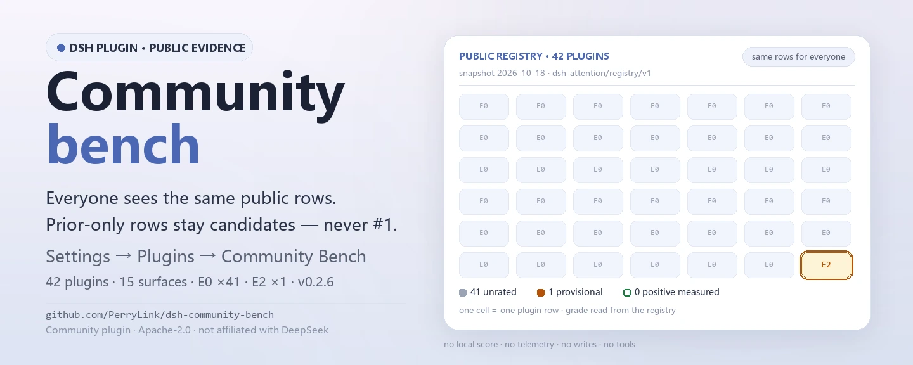
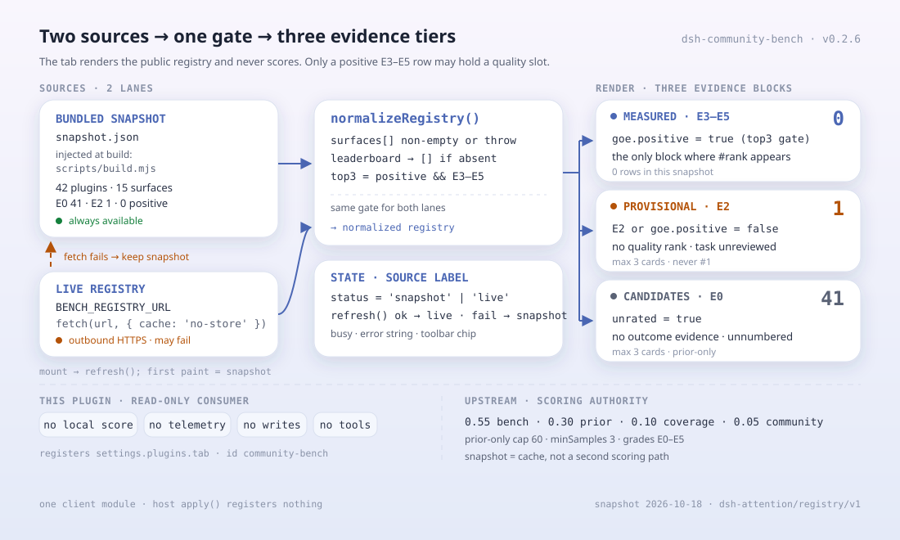

<div align="center">

<picture>
  <source media="(prefers-color-scheme: dark)" srcset="docs/assets/dsh-community-bench-hero-en-dark.webp">
  
</picture>

# dsh-community-bench

**Aba Community Bench dentro do app para a camada de evidência pública do `dsh-score`.**

*Lê o mesmo registro público que todo mundo vê. Sem pontuação local, sem telemetria, sem ranking pago.*

[English](README.md) · [简体中文](README-zh.md) · [Español](README-es.md) · [Português](README-pt.md) · [हिन्दी](README-hi.md)

> 🧊 **CONGELADO — 2026-10-31. Modo de manutenção.** Sem novos recursos de pontuação ou ranking; o pacote continua instalável.

[](LICENSE)
[](#compatibility)
[](https://www.npmjs.com/package/dsh-community-bench)
[](#compatibility)

[](https://github.com/PerryLink/dsh-community-bench/stargazers)
[](https://www.npmjs.com/package/dsh-community-bench)
[](https://dshfind.com/plugins/PerryLink/dsh-community-bench?ref=badge)
[](https://gitee.com/perrylink/dsh-community-bench)

```sh
dsh plugin --profile web add dsh-community-bench
```

</div>

<sub>Plugin da comunidade, não afiliado à DeepSeek. Repositório canônico: <https://github.com/PerryLink/dsh-community-bench> (o Gitee é um espelho).</sub>

---

> **Status: consumidor de referência / modo de manutenção.** Sem novos recursos de pontuação ou ranking. A camada de evidência pública é o `dsh-score-index` (atualmente `dsh-attention-index`; a renomeação do repo está pendente).

## O que mostra

- GOE (`E0`–`E5`) por superfície. No snapshot atual: 41 linhas são `E0 / unrated`, 1 linha é `E2 / provisional` (um pilot nulo); nenhuma linha positive measured.
- Linhas positive measured só no bloco de qualidade; linhas prior-only são rotuladas como candidatas, nunca como `#1`.
- Prior, bench, cobertura e **completude da evidência** (não uma probabilidade de confiança).
- Blocos de atenção da comunidade e reputação de contribuidores.
- Link para o site público de evidência e um botão de atualização.

A aba é um **consumidor**: a evidência e a classificação vivem no registro público, não neste plugin. Se o registro ao vivo estiver inacessível, ela volta ao snapshot incluído e o rotula.

<picture>
  <source media="(prefers-color-scheme: dark)" srcset="docs/assets/dsh-community-bench-flow-v5-dark.svg">
  
</picture>

*Estrutura: duas vias (snapshot injetado no build e registro ao vivo) → um portão `normalizeRegistry()` → três blocos de evidência; só uma linha positive E3–E5 pode ocupar uma vaga de qualidade, um fetch que falha mantém o snapshot, e os pesos de pontuação ficam a montante. Os rótulos de token dentro do diagrama são identificadores reais, então a mesma imagem serve aos cinco idiomas.*

## Instalação

```sh
dsh plugin --profile web add dsh-community-bench
```

Depois abra **Settings → Plugins → Community Bench**.

## Configuração

O build injeta duas URLs (`scripts/build.mjs`):

| Variável de ambiente no build | Padrão |
|---|---|
| `BENCH_SITE_URL` | `https://perrylink.github.io/dsh-attention-index/` |
| `BENCH_REGISTRY_URL` | `https://raw.githubusercontent.com/PerryLink/dsh-attention-index/main/data/registry.json` |

Se o registro for hospedado em outro lugar, rebuild com essas variáveis.

## Limites

- O snapshot incluído é gerado a partir de `dsh-attention-index/data/registry.json`; é um cache, não um segundo caminho de pontuação.
- O fetch ao vivo depende de o host permitir HTTPS de saída a partir do app Web; em caso de falha, a aba permanece no snapshot.
- Sem escritas locais, sem telemetria, sem ferramentas.

## Avaliação


*Animado: o próprio passo de build do repositório e um dry-run do pacote, reexecutados em 2026-11-21. A aba é uma visão somente de cliente sem CLI, então esta é a sua execução: o snapshot incluído é injetado em `client.js` e as mídias da documentação viajam com o pacote npm. Sem rede e sem captura de UI.*

## A família de plugins DSH

| Projeto | Papel |
|---|---|
| **[dsh-aqua-input-check](https://github.com/PerryLink/dsh-aqua-input-check)** |  |
| **[dsh-archive-check](https://github.com/PerryLink/dsh-archive-check)** |  |
| **[dsh-auto-review](https://github.com/PerryLink/dsh-auto-review)** |  |
| **[dsh-bid-ca-precheck](https://github.com/PerryLink/dsh-bid-ca-precheck)** |  |
| **[dsh-bid-qual-check](https://github.com/PerryLink/dsh-bid-qual-check)** |  |
| **[dsh-check-pack](https://github.com/PerryLink/dsh-check-pack)** |  |
| **[dsh-checkpoint-rewind](https://github.com/PerryLink/dsh-checkpoint-rewind)** |  |
| **[dsh-click](https://github.com/PerryLink/dsh-click)** |  |
| **[dsh-clinic](https://github.com/PerryLink/dsh-clinic)** |  |
| **[dsh-codemod](https://github.com/PerryLink/dsh-codemod)** |  |
| **[dsh-composer-history](https://github.com/PerryLink/dsh-composer-history)** |  |
| **[dsh-contract-stance](https://github.com/PerryLink/dsh-contract-stance)** |  |
| **[dsh-customs-doc-check](https://github.com/PerryLink/dsh-customs-doc-check)** |  |
| **[dsh-data-quality](https://github.com/PerryLink/dsh-data-quality)** |  |
| **[dsh-demurrage-ledger](https://github.com/PerryLink/dsh-demurrage-ledger)** |  |
| **[dsh-dida](https://github.com/PerryLink/dsh-dida)** |  |
| **[dsh-doublecheck](https://github.com/PerryLink/dsh-doublecheck)** |  |
| **[dsh-drill-script-check](https://github.com/PerryLink/dsh-drill-script-check)** |  |
| **[dsh-eia-guide-check](https://github.com/PerryLink/dsh-eia-guide-check)** |  |
| **[dsh-emergency-plan](https://github.com/PerryLink/dsh-emergency-plan)** |  |
| **[dsh-essay-rubric-check](https://github.com/PerryLink/dsh-essay-rubric-check)** |  |
| **[dsh-evidence-check](https://github.com/PerryLink/dsh-evidence-check)** |  |
| **[dsh-export-ctl-check](https://github.com/PerryLink/dsh-export-ctl-check)** |  |
| **[dsh-fast](https://github.com/PerryLink/dsh-fast)** |  |
| **[dsh-fmea-table-check](https://github.com/PerryLink/dsh-fmea-table-check)** |  |
| **[dsh-forecast-penalty](https://github.com/PerryLink/dsh-forecast-penalty)** |  |
| **[dsh-fund-research](https://github.com/PerryLink/dsh-fund-research)** |  |
| **[dsh-github-bot](https://github.com/PerryLink/dsh-github-bot)** |  |
| **[dsh-gongwen-flow-check](https://github.com/PerryLink/dsh-gongwen-flow-check)** |  |
| **[dsh-gongwen-word-check](https://github.com/PerryLink/dsh-gongwen-word-check)** |  |
| **[dsh-guard-plan-qc](https://github.com/PerryLink/dsh-guard-plan-qc)** |  |
| **[dsh-hazchem-check](https://github.com/PerryLink/dsh-hazchem-check)** |  |
| **[dsh-hazplan-check](https://github.com/PerryLink/dsh-hazplan-check)** |  |
| **[dsh-hidden-risk-map](https://github.com/PerryLink/dsh-hidden-risk-map)** |  |
| **[dsh-hs-classify](https://github.com/PerryLink/dsh-hs-classify)** |  |
| **[dsh-icd-rule-check](https://github.com/PerryLink/dsh-icd-rule-check)** |  |
| **[dsh-industry-research](https://github.com/PerryLink/dsh-industry-research)** |  |
| **[dsh-lawcite-adapter](https://github.com/PerryLink/dsh-lawcite-adapter)** |  |
| **[dsh-laya](https://github.com/PerryLink/dsh-laya)** |  |
| **[dsh-lc-doc-check](https://github.com/PerryLink/dsh-lc-doc-check)** |  |
| **[dsh-learning-gap-check](https://github.com/PerryLink/dsh-learning-gap-check)** |  |
| **[dsh-library](https://github.com/PerryLink/dsh-library)** |  |
| **[dsh-local-ai](https://github.com/PerryLink/dsh-local-ai)** |  |
| **[dsh-lsp-actions](https://github.com/PerryLink/dsh-lsp-actions)** |  |
| **[dsh-mask](https://github.com/PerryLink/dsh-mask)** |  |
| **[dsh-mcp-panel](https://github.com/PerryLink/dsh-mcp-panel)** |  |
| **[dsh-medrec-qc](https://github.com/PerryLink/dsh-medrec-qc)** |  |
| **[dsh-memento](https://github.com/PerryLink/dsh-memento)** |  |
| **[dsh-nsfc-form-check](https://github.com/PerryLink/dsh-nsfc-form-check)** |  |
| **[dsh-nurse-record-check](https://github.com/PerryLink/dsh-nurse-record-check)** |  |
| **[dsh-observe](https://github.com/PerryLink/dsh-observe)** |  |
| **[dsh-origin-rvc-check](https://github.com/PerryLink/dsh-origin-rvc-check)** |  |
| **[dsh-ota-review-check](https://github.com/PerryLink/dsh-ota-review-check)** |  |
| **[dsh-output-styles](https://github.com/PerryLink/dsh-output-styles)** |  |
| **[dsh-paper-doc-adapter](https://github.com/PerryLink/dsh-paper-doc-adapter)** |  |
| **[dsh-param-repair](https://github.com/PerryLink/dsh-param-repair)** |  |
| **[dsh-permission-rules](https://github.com/PerryLink/dsh-permission-rules)** |  |
| **[dsh-permit-report-check](https://github.com/PerryLink/dsh-permit-report-check)** |  |
| **[dsh-phocinae](https://github.com/PerryLink/dsh-phocinae)** |  |
| **[dsh-phone-inbox](https://github.com/PerryLink/dsh-phone-inbox)** |  |
| **[dsh-pipeline-check](https://github.com/PerryLink/dsh-pipeline-check)** |  |
| **[dsh-pleading-draft](https://github.com/PerryLink/dsh-pleading-draft)** |  |
| **[dsh-policy-brief-draft](https://github.com/PerryLink/dsh-policy-brief-draft)** |  |
| **[dsh-power-loss-split](https://github.com/PerryLink/dsh-power-loss-split)** |  |
| **[dsh-power-ticket-check](https://github.com/PerryLink/dsh-power-ticket-check)** |  |
| **[dsh-ppap-check](https://github.com/PerryLink/dsh-ppap-check)** |  |
| **[dsh-primer](https://github.com/PerryLink/dsh-primer)** |  |
| **[dsh-protest-deadline](https://github.com/PerryLink/dsh-protest-deadline)** |  |
| **[dsh-railway-window](https://github.com/PerryLink/dsh-railway-window)** |  |
| **[dsh-repair-order-qc](https://github.com/PerryLink/dsh-repair-order-qc)** |  |
| **[dsh-research-report](https://github.com/PerryLink/dsh-research-report)** |  |
| **[dsh-review-reply-check](https://github.com/PerryLink/dsh-review-reply-check)** |  |
| **[dsh-rulefile-check](https://github.com/PerryLink/dsh-rulefile-check)** |  |
| **[dsh-safety-brief-check](https://github.com/PerryLink/dsh-safety-brief-check)** |  |
| **[dsh-scaffold](https://github.com/PerryLink/dsh-scaffold)** |  |
| **[dsh-score](https://github.com/PerryLink/dsh-score)** | Inspetor local de priors de cinco dimensões |
| **[dsh-security-pack](https://github.com/PerryLink/dsh-security-pack)** |  |
| **[dsh-session-sync](https://github.com/PerryLink/dsh-session-sync)** |  |
| **[dsh-site-log-check](https://github.com/PerryLink/dsh-site-log-check)** |  |
| **[dsh-soe-decision-check](https://github.com/PerryLink/dsh-soe-decision-check)** |  |
| **[dsh-soilwater-check](https://github.com/PerryLink/dsh-soilwater-check)** |  |
| **[dsh-sop-sync-check](https://github.com/PerryLink/dsh-sop-sync-check)** |  |
| **[dsh-spc-gbt-adapter](https://github.com/PerryLink/dsh-spc-gbt-adapter)** |  |
| **[dsh-talk](https://github.com/PerryLink/dsh-talk)** |  |
| **[dsh-tender-extract](https://github.com/PerryLink/dsh-tender-extract)** |  |
| **[dsh-tender-matrix](https://github.com/PerryLink/dsh-tender-matrix)** |  |
| **[dsh-test-drive](https://github.com/PerryLink/dsh-test-drive)** |  |
| **[dsh-warranty-calc](https://github.com/PerryLink/dsh-warranty-calc)** |  |
| **[dsh-autotier](https://github.com/PerryLink/dsh-autotier)** | 🧊 CONGELADO — ver o README do repositório |
| **[dsh-budget](https://github.com/PerryLink/dsh-budget)** | 🧊 CONGELADO — ver o README do repositório |
| **[dsh-cert-mcp](https://github.com/PerryLink/dsh-cert-mcp)** | 🧊 CONGELADO — ver o README do repositório |
| **[dsh-claude-move](https://github.com/PerryLink/dsh-claude-move)** | 🧊 CONGELADO — ver o README do repositório |
| **[dsh-community-bench](https://github.com/PerryLink/dsh-community-bench)** | 🧊 CONGELADO — ver o README do repositório |
| **[dsh-defend](https://github.com/PerryLink/dsh-defend)** | 🧊 CONGELADO — ver o README do repositório |
| **[dsh-draw](https://github.com/PerryLink/dsh-draw)** | 🧊 CONGELADO — ver o README do repositório |
| **[dsh-reach](https://github.com/PerryLink/dsh-reach)** | 🧊 CONGELADO — ver o README do repositório |
| **[dsh-background-agents](https://github.com/PerryLink/dsh-background-agents)** | 🚫 RETIRADO — ver o README do repositório |
| **[dsh-session-pin](https://github.com/PerryLink/dsh-session-pin)** | 🚫 RETIRADO — ver o README do repositório |
| **[dsh-team-rooms](https://github.com/PerryLink/dsh-team-rooms)** | 🚫 RETIRADO — ver o README do repositório |

## ⭐ Se foi útil para você

Este plugin faz parte de uma [família de plugins DSH](https://github.com/PerryLink) (40+, todos Apache-2.0). Se for útil, **uma estrela ajuda a próxima pessoa a encontrá-lo** — nada fica bloqueado atrás dela.

## Licença

Apache-2.0.
