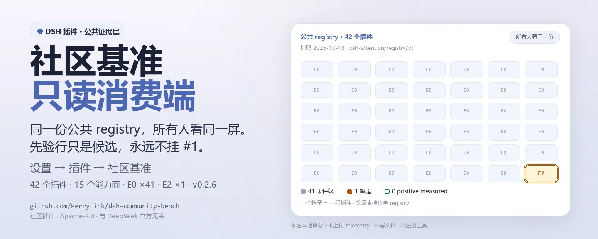
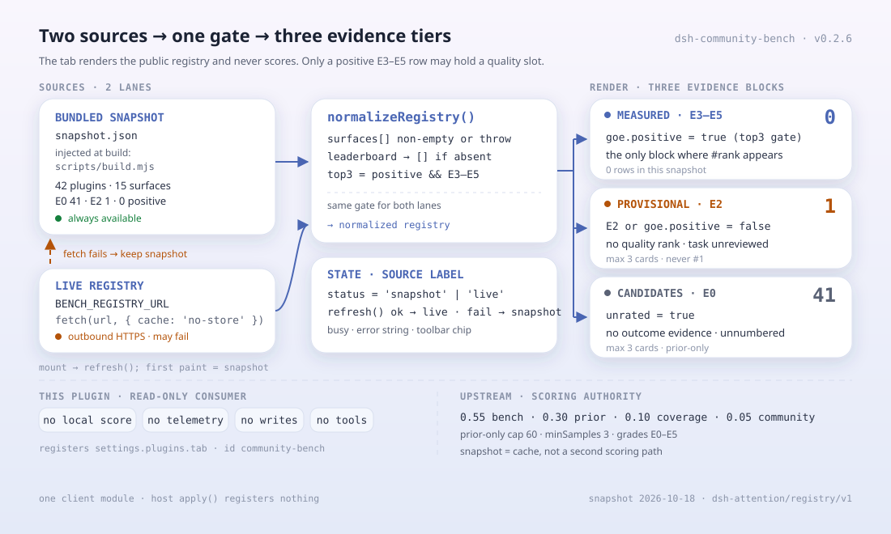

<div align="center">

<picture>
  <source media="(prefers-color-scheme: dark)" srcset="docs/assets/dsh-community-bench-hero-zh-dark.webp">
  
</picture>

# dsh-community-bench

**面向 `dsh-score` 公共证据层的应用内社区基准标签页。**

*读取所有人看到的同一份公共 registry。不在本地算分，不上报 telemetry，不卖排名。*

[English](README.md) · [Español](README-es.md) · [Português](README-pt.md) · [हिन्दी](README-hi.md)

> 🧊 **2026-10-31 起冻结，维护模式。** 不再新增评分/排名功能；包仍可安装。

[](LICENSE)
[](#compatibility)
[](https://www.npmjs.com/package/dsh-community-bench)
[](#compatibility)

[](https://github.com/PerryLink/dsh-community-bench/stargazers)
[](https://www.npmjs.com/package/dsh-community-bench)
[](https://dshfind.com/plugins/PerryLink/dsh-community-bench?ref=badge)
[](https://gitee.com/perrylink/dsh-community-bench)

```sh
dsh plugin --profile web add dsh-community-bench
```

</div>

<sub>社区插件，与 DeepSeek 无关。主仓库：<https://github.com/PerryLink/dsh-community-bench>（Gitee 为镜像）。</sub>

---

> **状态：参考消费者 / 维护模式。** 不再新增评分或排名功能。公共证据层是
> `dsh-score-index`（当前为 `dsh-attention-index`；repo 改名待执行）。

## 展示什么

- 每个能力面的 GOE（`E0`–`E5`）。当前快照：41 行是 `E0 / unrated`，1 行是 `E2 / provisional`（零效应 pilot）；没有 positive measured 行。
- 只有 positive measured 进质量块；prior-only 行标注为候选，永远不是 `#1`。
- prior、bench、覆盖率和**证据完整度**（不是置信概率）。
- 社区注意力块与贡献者声誉。
- 公共证据站链接与刷新按钮。

这个标签页只是**消费端**：证据与评级都在公共 registry 里，不在本插件里。在线 registry 不可达时，回退到内置快照并明确标注。

<picture>
  <source media="(prefers-color-scheme: dark)" srcset="docs/assets/dsh-community-bench-flow-v5-dark.svg">
  
</picture>

*结构：两条通道（构建时注入的快照与在线 registry）→ 一个 `normalizeRegistry()` 闸门 → 三个证据块；只有 positive 的 E3–E5 行能占质量槽位，抓取失败保留快照，评分权重始终在上游。图内只有真实标识符，五语共用同一张结构图。*

## 安装

```sh
dsh plugin --profile web add dsh-community-bench
```

然后打开 **Settings → Plugins → Community Bench**。

## 配置

构建时注入两个 URL（`scripts/build.mjs`）：

| 构建环境变量 | 默认值 |
|---|---|
| `BENCH_SITE_URL` | `https://perrylink.github.io/dsh-attention-index/` |
| `BENCH_REGISTRY_URL` | `https://raw.githubusercontent.com/PerryLink/dsh-attention-index/main/data/registry.json` |

如果 registry 部署在别处，用这两个变量重新构建。

## 边界

- 内置快照来自 `dsh-attention-index/data/registry.json`；它是缓存，不是第二套打分。
- 在线刷新依赖 Web 应用允许出站 HTTPS；失败时停留在快照。
- 不写本地文件、不上报 telemetry、不注册工具。

## 评测


*动图是本仓库自己的构建步骤与打包 dry-run 的 2026-11-21 回放。标签页是纯客户端视图、没有 CLI，所以这就是它的运行：内置快照被注入 `client.js`，文档配图随 npm 包一起发布。不联网、不截 UI。*

## DSH 插件家族

| 项目 | 角色 |
|---|---|
| **[dsh-score](https://github.com/PerryLink/dsh-score)** | 本地五维先验检查器 |
| **[dsh-score index](https://github.com/PerryLink/dsh-attention-index)** | 公共证据层（E0–E5、API、signals） |
| **dsh-community-bench**（本插件） | 应用内消费端 |
| **[dsh-kit](https://github.com/PerryLink/dsh-kit)** | 家族一键安装包 |

## ⭐ 如果它帮到了你

这个插件是 [DSH 插件家族](https://github.com/PerryLink)的一员（40+ 个，全部 Apache-2.0）。如果你在用，**给个 star** —— 它不会解锁任何功能，但会让下一个人在搜索里更容易找到它。

## License

Apache-2.0.
